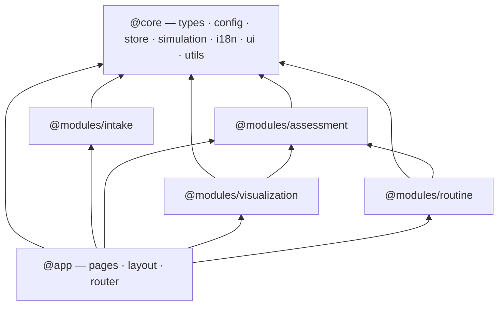

# AstroVital 🛰️🫀

**Live demo:** https://emir-pek.github.io/astroVital/

Runs fully in the browser with simulated crew data; prototype decision-support tool, not a
medical device. Each visitor's data stays in their own browser.

**Crew health, in plain language.** A visual self-monitoring tool for astronauts on long-duration
missions — built for the **NASA Space Apps Challenge 2026 · Health Monitoring Software**.

> ⚠️ **Prototype — not a medical device.** All data is simulated. Thresholds are configurable
> starting points backed by cited sources ([docs/SOURCES.md](docs/SOURCES.md)), not medical advice.

## What it does

- **Collects** blood pressure, heart rate, blood glucose, body temperature, sleep, mood, SpO₂,
  respiration rate, radiation dose and exercise — by keyboard, tap (glove-friendly), camera
  (experimental rPPG heart rate) or ultrasound image.
- **Assesses** every value with green / yellow / red thresholds adapted to the environment
  (ISS, deep-space spacecraft, rover, lunar base, Mars base) and explains the result **in plain
  language** — never assuming the astronaut is a doctor.
- **Guides**: recommendations (rest, hydrate, re-measure, shelter from radiation, …) and
  **escalation** — self-care → Crew Medical Officer → flight surgeon → emergency (on Mars:
  autonomous protocol with asynchronous report, because of the 4–24 min signal delay).
- **Shows** an interactive, animated **body map**: tap a region to see what it does, how
  spaceflight threatens it (NASA's 5 hazards) and its current status. Trend charts, live vitals.
- **Supports the routine**: mission-time reminders and gamified health missions that reward
  **adherence**, not "good numbers".
- **Offline-first**: no backend, no network calls — runs from a static folder on a spacecraft LAN.
- **EN / TR** user interface.

## Quick start

Requires Node.js ≥ 22 (tested with Node 24 LTS), npm and git. No Python/venv needed.

**One command** (installs dependencies, git hooks, the team's Claude Code plugins, then checks everything):

```powershell
# Windows (PowerShell)
git clone https://github.com/Emir-pek/astroVital.git
cd astroVital
powershell -ExecutionPolicy Bypass -File scripts\setup.ps1
npm run dev
```

```bash
# macOS / Linux / WSL / Git Bash
git clone https://github.com/Emir-pek/astroVital.git
cd astroVital
bash scripts/setup.sh
npm run dev
```

Open http://localhost:5173 — demo data loads automatically on first start. **New to the team?** Follow
[Team onboarding](#team-onboarding-step-by-step) — every step has a check. No local install at all?
Open the repo in **GitHub Codespaces**; the dev container runs the same setup.

Manual alternative: `npm ci && npm run dev`. Something missing or out of date? `npm run doctor`, then
the full checklist in [docs/SETUP_CHECK.md](docs/SETUP_CHECK.md) (tools, dependency versions, health
checks + the dependency registry that must be updated whenever a package is added).

| Command                                                     | Purpose                                                                |
| ----------------------------------------------------------- | ---------------------------------------------------------------------- |
| `npm run dev`                                               | Development server                                                     |
| `npm run build`                                             | Type-check + production build to `dist/` (relative base, hash routing) |
| `npm run preview`                                           | Serve the production build                                             |
| `npm test` / `npm run test:watch` / `npm run test:coverage` | Vitest + React Testing Library                                         |
| `npm run lint`                                              | ESLint (incl. module-boundary rules), zero warnings allowed            |
| `npm run typecheck`                                         | `tsc -b --noEmit` (strict)                                             |
| `npm run format`                                            | Prettier                                                               |
| `npm run verify`                                            | lint + typecheck + test + build — run before every merge               |
| `npm run docs:contracts`                                    | Sync `docs/CONTRACTS.md` from `src/core/types`                         |
| `npm run doctor`                                            | Check tools, dependencies, git hooks and Claude plugins                |
| `npm run docs:check`                                        | Check that your changes have a `CHANGELOG.md` entry                    |
| `npm run claude:setup`                                      | (Re)install the team's Claude Code plugins                             |

## Team onboarding (step by step)

Every team member does this **once**. Each step ends with a **Verify** line — don't move on until it
matches. Commands run in the repo folder (Windows: PowerShell or Command Prompt; macOS/Linux:
terminal). Stuck? Run `npm run doctor` and paste the output in the team channel.

### 1. Install the tools

| Tool                        | Version                    | Windows                                  | macOS / Linux                          |
| --------------------------- | -------------------------- | ---------------------------------------- | -------------------------------------- |
| Git                         | ≥ 2.40                     | `winget install Git.Git`                 | `xcode-select --install` / apt         |
| Node.js                     | ≥ 22 (Node 24 LTS tested)  | `winget install OpenJS.NodeJS.LTS`       | https://nodejs.org or `nvm install 24` |
| Claude Code                 | latest, own Claude account | https://code.claude.com/docs/en/overview | same                                   |
| GitHub Desktop _(optional)_ | latest                     | https://desktop.github.com               | same                                   |

**Verify:** open a **new** terminal and run `git --version`, `node -v`, `npm -v`, `claude --version` —
each prints a version (node `v22` or higher).

### 2. Get access and clone

1. Accept the GitHub collaborator invitation for `Emir-pek/astroVital` (check your e-mail).
2. Clone the repo:
   - **GitHub Desktop:** File → Clone repository → GitHub.com → `astroVital` → Clone.
   - **Terminal:** `git clone https://github.com/Emir-pek/astroVital.git && cd astroVital`
3. Switch to **your** branch (see [Team & workflow](#team--workflow)): GitHub Desktop → Current branch →
   `feat/<your-area>`, or `git switch feat/<your-area>`.

**Verify:** `git branch --show-current` prints your branch, and `CHANGELOG.md`, `.mcp.json` and
`scripts/setup.ps1` exist in the folder (`dir /a` on Windows, `ls -a` elsewhere).

### 3. Run the setup script

```powershell
powershell -ExecutionPolicy Bypass -File scripts\setup.ps1   # Windows
```

```bash
bash scripts/setup.sh                                         # macOS / Linux / Git Bash
```

GitHub Desktop users: Repository → **Open in Command Prompt** opens a terminal in the right folder.

**Verify:** the script ends with `Setup finished.` and the check block shows ✔ for Node.js, npm,
git, `node_modules`, `npm ls`, `Git hook'ları (.githooks)` and all five `plugin …` lines. A `•` line
for `typescript-language-server` is optional (install with
`npm i -g typescript-language-server typescript`). A `DeprecationWarning` line is harmless.

### 4. Check the project builds

```bash
npm run verify
```

**Verify:** `Tests  87 passed` (or more), then `✓ built`. The yellow "chunks are larger than 500 kB"
message is a known, accepted warning (ADR-021).

### 5. Run the app

```bash
npm run dev
```

**Verify:** http://localhost:5173 shows four crew cards, the MET clock at the top and the yellow
"Prototype — not a medical device" banner. Stop with `Ctrl+C`.

### 6. Open Claude Code in the repo and trust it

In the repo folder run `claude` (or open the folder in the Claude desktop app's **Code** tab or the
VS Code extension — **not** the regular chat). When asked _"Do you trust the files in this folder?"_
answer **Yes**. Project plugins, MCP servers and hooks only load in trusted folders.

**Verify — MCP servers:** exit Claude (`/exit`) and run `claude mcp list`:

```text
playwright: npx @playwright/mcp@latest - ✔ Connected
context7: https://mcp.context7.com/mcp (HTTP) - ✔ Connected
github: https://api.githubcopilot.com/mcp/ (HTTP) - ✗ Failed to connect   ← expected without a token
```

`github` is optional: create a fine-grained token (see `.env.example`), then
`setx GITHUB_PERSONAL_ACCESS_TOKEN "<token>"` (Windows) or `export …` in your shell profile, open a
new terminal and run `claude mcp list` again.

**Verify — plugins:** in Claude run `/plugin` → **Installed**. Under **Project** you see
`claude-md-management`, `commit-commands`, `frontend-design`, `pr-review-toolkit`, `typescript-lsp`
(✔) plus `context7` and `playwright`.

**Verify — skills:** type `/` — `/document-change`, `/space-apps-submission` and
`/commit-commands:commit` are listed.

**Verify — hooks:** ask Claude _"What did the team change recently?"_ — it answers from the latest
`CHANGELOG.md` entries (loaded by the SessionStart hook).

### 7. Try the documentation guard once

Make any small change under `src/`, then `git add -A && git commit -m "test"`.

**Verify:** the commit is **rejected** with `✖ docs-check: kod/config değişti ama CHANGELOG.md
güncellenmedi`. Undo the test change (GitHub Desktop: Discard changes, or `git restore --staged . &&
git restore .`).

### 8. Daily workflow

1. Start: `git pull` on your branch — new teammates' `CHANGELOG.md` entries are printed; if it says
   "re-run setup", run step 3 again.
2. Bring in `main`: `git fetch origin && git merge origin/main`.
3. Work (with Claude Code or by hand).
4. Document: add a `CHANGELOG.md` entry, or ask Claude _"bu değişikliği dokümante et"_.
5. `npm run verify` → commit (Conventional Commits) → `git push origin feat/<your-area>`.
6. Open a **pull request** to `main`. It merges when CI (`verify` + `docs`) is green and one teammate
   approves. Direct pushes to `main` are blocked.

### Onboarding checklist

```text
[ ] 1 tools installed (git, node ≥22, claude)      [ ] 5 app runs on :5173
[ ] 2 cloned, on my feat/* branch                   [ ] 6 trusted; playwright + context7 connected;
[ ] 3 setup.ps1 / setup.sh → all ✔                        5 plugins + skills visible
[ ] 4 npm run verify → tests pass, ✓ built          [ ] 7 docs guard rejected an undocumented commit
```

## Architecture at a glance



- Modules talk to each other **only through their `index.ts`** (`@modules/<name>`); ESLint
  (`no-restricted-imports`) and TypeScript `paths` reject deep or cross-graph imports.
- Shared contracts live in `src/core/types` and are mirrored verbatim in
  [docs/CONTRACTS.md](docs/CONTRACTS.md) (a test enforces it).
- Stack: Vite 8 · React 19 · TypeScript 6 (strict) · React Router 8 · Zustand 5 (+persist) ·
  Zod 4 · Recharts 3 · Framer Motion · Tailwind CSS 4 · i18next · date-fns · lucide-react ·
  Vitest 5 + Testing Library.

Details: [docs/ARCHITECTURE.md](docs/ARCHITECTURE.md) · decisions: [docs/DECISIONS.md](docs/DECISIONS.md).

```
src/
├── app/            shell: router, layout (MET clock, environment badge, language), pages
├── core/           types, config (metrics, thresholds, environments, hazards, body regions, sources),
│                   store, simulation (seeded), i18n (en/tr), ui kit, utils
├── modules/
│   ├── intake/         data capture
│   ├── assessment/     rules engine, alerts, learn panel
│   ├── visualization/  body map, charts, vitals, crew overview
│   └── routine/        reminders, gamification, MET clock
└── test/           shared test helpers (@test/*)
```

## Simulated data

There is no real dataset for this challenge. `generateHistory()` (seeded mulberry32 PRNG) creates
a deterministic history for a fictional 4-person crew with individual baselines, realistic noise
and daily rhythm. Scenarios (Settings page): `nominal`, `space_adaptation`, `solar_particle_event`,
`isolation_stress`, `fever_dehydration`, `orthostatic_return`.

## Team & workflow

Four engineers work in parallel on separate branches — see [docs/TEAM.md](docs/TEAM.md) and the
per-module task lists in [docs/modules/](docs/modules/). Plan & timeline: [docs/PLAN.md](docs/PLAN.md).

| Engineer | Area                        | Branch               |
| -------- | --------------------------- | -------------------- |
| 1        | Platform, core & routine    | `feat/core-routine`  |
| 2        | Intake (data capture)       | `feat/intake`        |
| 3        | Assessment, risk & guidance | `feat/assessment`    |
| 4        | Visualization & dashboard   | `feat/visualization` |

### Parallel work on one machine (git worktree)

```bash
git worktree add ../astrovital-core-routine  feat/core-routine
git worktree add ../astrovital-intake        feat/intake
git worktree add ../astrovital-assessment    feat/assessment
git worktree add ../astrovital-visualization feat/visualization

cd ../astrovital-intake
npm install
npm run dev -- --port 5174     # use a different port per worktree
```

Changes reach `main` **only through pull requests**: push your own `feat/*` branch, open a PR, and
merge after CI (`verify` + `docs`) is green and one teammate approves (changes under `src/core` need
Engineer 1's approval). Merge into `main` at least twice a day. Commits follow
[Conventional Commits](https://www.conventionalcommits.org/) (`feat(intake): …`, `fix(assessment): …`).
Never force-push. Repository: `https://github.com/Emir-pek/astroVital` (details:
[docs/TEAM.md](docs/TEAM.md)).

## Every change is documented

Every code/config change gets an entry in [CHANGELOG.md](CHANGELOG.md) (newest first: what, why,
files, what teammates must do), plus the matching `docs/` file when behaviour changes. Enforced by
a git `pre-commit` hook, the CI `docs` job and a Claude Code `Stop` hook. After `git pull`, a
`post-merge` hook prints teammates' new entries; every Claude Code session starts with them loaded.

## Claude Code for the team

The team's AI tooling lives in this repo and is maintained by the tooling owner:
`CLAUDE.md` (rules, per module too), `.claude/skills/` (custom skills), `.claude/settings.json`
(plugins, hooks, permissions) and `.mcp.json` (MCP servers: Playwright, Context7, GitHub). Clone,
run setup, start `claude` in the repo and accept the trust prompt. Use local Claude Code sessions:
cloud sessions load `CLAUDE.md` only. Guide (Turkish): [docs/CLAUDE_SETUP.md](docs/CLAUDE_SETUP.md).

## AI usage

AI tools (Anthropic Claude) were used to help write code, tests and documentation and to research
sources; every change was reviewed by a team member and had to pass CI. The app itself uses no AI at
runtime. Full disclosure, as required by the Space Apps submission guide: [AI.md](AI.md).

## Science

Every threshold and recommendation links to a source ID in [docs/SOURCES.md](docs/SOURCES.md)
(NASA HRP 5 Hazards, NASA Human Research Roadmap, CSA radiation monitoring, NASA-STD-3001,
ACC/AHA, ADA, NEWS2, peer-reviewed spaceflight studies). Tables: [docs/THRESHOLDS.md](docs/THRESHOLDS.md),
[docs/HAZARDS.md](docs/HAZARDS.md). Jury demo: [docs/DEMO_SCRIPT.md](docs/DEMO_SCRIPT.md).

## License

See [LICENSE](LICENSE).
