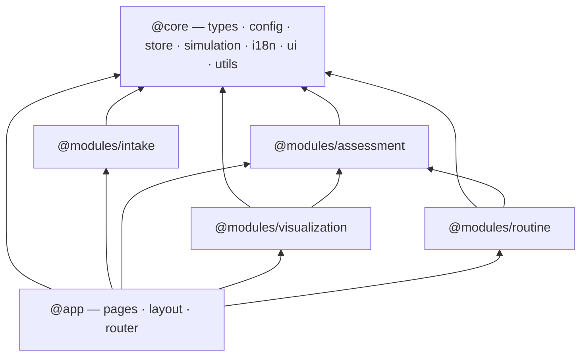

# AstroVital 🛰️🫀

**Crew health, in plain language.** A visual self-monitoring tool for astronauts on long-duration
missions — built for the **NASA Space Apps Challenge 2026 · Health Monitoring Software**.

> ⚠️ **Prototype — not a medical device.** All data is simulated. Thresholds are configurable
> starting points backed by cited sources ([docs/SOURCES.md](docs/SOURCES.md)), not medical advice.

## What it does

- **Collects** blood pressure, heart rate, blood glucose, body temperature, sleep, mood, SpO₂,
  respiration rate, radiation dose and exercise — by keyboard, tap (glove-friendly), camera
  (experimental rPPG heart rate) or ultrasound image.
- **Assesses** every value with green / yellow / red thresholds adapted to the environment
  (ISS, deep-space spacecraft, rover, lunar base, Mars base) and explains the result **in plain
  language** — never assuming the astronaut is a doctor.
- **Guides**: recommendations (rest, hydrate, re-measure, shelter from radiation, …) and
  **escalation** — self-care → Crew Medical Officer → flight surgeon → emergency (on Mars:
  autonomous protocol with asynchronous report, because of the 4–24 min signal delay).
- **Shows** an interactive, animated **body map**: tap a region to see what it does, how
  spaceflight threatens it (NASA's 5 hazards) and its current status. Trend charts, live vitals.
- **Supports the routine**: mission-time reminders and gamified health missions that reward
  **adherence**, not "good numbers".
- **Offline-first**: no backend, no network calls — runs from a static folder on a spacecraft LAN.
- **EN / TR** user interface.

## Quick start

Requires Node.js ≥ 22 (tested with Node 24 LTS) and npm.

```bash
npm install
npm run dev        # http://localhost:5173 — demo data loads automatically on first start
```

| Command                                                     | Purpose                                                                |
| ----------------------------------------------------------- | ---------------------------------------------------------------------- |
| `npm run dev`                                               | Development server                                                     |
| `npm run build`                                             | Type-check + production build to `dist/` (relative base, hash routing) |
| `npm run preview`                                           | Serve the production build                                             |
| `npm test` / `npm run test:watch` / `npm run test:coverage` | Vitest + React Testing Library                                         |
| `npm run lint`                                              | ESLint (incl. module-boundary rules), zero warnings allowed            |
| `npm run typecheck`                                         | `tsc -b --noEmit` (strict)                                             |
| `npm run format`                                            | Prettier                                                               |
| `npm run verify`                                            | lint + typecheck + test + build — run before every merge               |
| `npm run docs:contracts`                                    | Sync `docs/CONTRACTS.md` from `src/core/types`                         |

## Architecture at a glance



- Modules talk to each other **only through their `index.ts`** (`@modules/<name>`); ESLint
  (`no-restricted-imports`) and TypeScript `paths` reject deep or cross-graph imports.
- Shared contracts live in `src/core/types` and are mirrored verbatim in
  [docs/CONTRACTS.md](docs/CONTRACTS.md) (a test enforces it).
- Stack: Vite 8 · React 19 · TypeScript 6 (strict) · React Router 8 · Zustand 5 (+persist) ·
  Zod 4 · Recharts 3 · Framer Motion · Tailwind CSS 4 · i18next · date-fns · lucide-react ·
  Vitest 5 + Testing Library.

Details: [docs/ARCHITECTURE.md](docs/ARCHITECTURE.md) · decisions: [docs/DECISIONS.md](docs/DECISIONS.md).

```
src/
├── app/            shell: router, layout (MET clock, environment badge, language), pages
├── core/           types, config (metrics, thresholds, environments, hazards, body regions, sources),
│                   store, simulation (seeded), i18n (en/tr), ui kit, utils
├── modules/
│   ├── intake/         data capture
│   ├── assessment/     rules engine, alerts, learn panel
│   ├── visualization/  body map, charts, vitals, crew overview
│   └── routine/        reminders, gamification, MET clock
└── test/           shared test helpers (@test/*)
```

## Simulated data

There is no real dataset for this challenge. `generateHistory()` (seeded mulberry32 PRNG) creates
a deterministic history for a fictional 4-person crew with individual baselines, realistic noise
and daily rhythm. Scenarios (Settings page): `nominal`, `space_adaptation`, `solar_particle_event`,
`isolation_stress`, `fever_dehydration`, `orthostatic_return`.

## Team & workflow

Four engineers work in parallel on separate branches — see [docs/TEAM.md](docs/TEAM.md) and the
per-module task lists in [docs/modules/](docs/modules/). Plan & timeline: [docs/PLAN.md](docs/PLAN.md).

| Engineer | Area                        | Branch               |
| -------- | --------------------------- | -------------------- |
| 1        | Platform, core & routine    | `feat/core-routine`  |
| 2        | Intake (data capture)       | `feat/intake`        |
| 3        | Assessment, risk & guidance | `feat/assessment`    |
| 4        | Visualization & dashboard   | `feat/visualization` |

### Parallel work on one machine (git worktree)

```bash
git worktree add ../astrovital-core-routine  feat/core-routine
git worktree add ../astrovital-intake        feat/intake
git worktree add ../astrovital-assessment    feat/assessment
git worktree add ../astrovital-visualization feat/visualization

cd ../astrovital-intake
npm install
npm run dev -- --port 5174     # use a different port per worktree
```

Merge into `main` at least twice a day after `npm run verify`. Commits follow
[Conventional Commits](https://www.conventionalcommits.org/) (`feat(intake): …`, `fix(assessment): …`).
Changes under `src/core` need Engineer 1's approval. **Local git only — no push, no new remotes**
(syncing between different computers: see [docs/TEAM.md](docs/TEAM.md)).

## Science

Every threshold and recommendation links to a source ID in [docs/SOURCES.md](docs/SOURCES.md)
(NASA HRP 5 Hazards, NASA Human Research Roadmap, CSA radiation monitoring, NASA-STD-3001,
ACC/AHA, ADA, NEWS2, peer-reviewed spaceflight studies). Tables: [docs/THRESHOLDS.md](docs/THRESHOLDS.md),
[docs/HAZARDS.md](docs/HAZARDS.md). Jury demo: [docs/DEMO_SCRIPT.md](docs/DEMO_SCRIPT.md).

## License

See [LICENSE](LICENSE).
