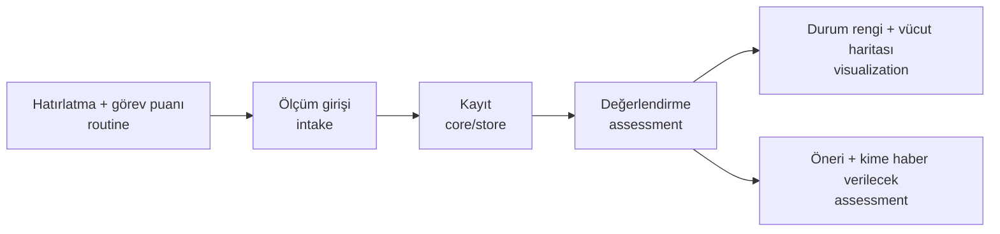

# ADIMLAR — Projeyi gündelik dille, örneklerle anlamak

> Bu dosya ekip içindir: "Bu proje ne yapıyor, ben nereye dokunacağım, nasıl çalışacağım?"
> sorularının sade cevabı. Teknik ayrıntı gerekiyorsa her bölümün sonunda hangi dosyaya bakacağın
> yazıyor. Kurulum adımları için: README › _Team onboarding (step by step)_.

---

## 1. Bu proje ne yapıyor?

**Ne:** AstroVital, uzun görevdeki bir astronotun kendi sağlığını kendisinin takip etmesini sağlayan
bir web uygulaması. Ölçümü giriyor, uygulama "bu normal mi?" sorusunu sade dille cevaplıyor ve ne
yapması gerektiğini söylüyor.

**Neden:** Mars'ta doktora hemen ulaşamazsın; mesajın dakikalar sonra gider. Astronot küçük bir
sorunu kendi fark edip büyümeden önlemek zorunda.

**Örnek:** Kenji Ay üssünde. Sabah ateşini ölçüyor: 37,8 °C. Uygulama:

1. Ateşi "dikkat" (sarı) olarak işaretler, vücut haritasında ilgili bölge sarı yanar.
2. Sade dille açıklar: "Vücut ısın normalin üstünde; enfeksiyon veya sıvı kaybı olabilir."
3. Ne yapacağını söyler: "Sıvı al, dinlen, 1 saat sonra tekrar ölç."
4. Ne zaman haber vereceğini söyler: "38 °C'yi geçerse durum kırmızıya döner; Crew Medical Officer'a bildir."

> Uygulama **tıbbi cihaz değil**, bir prototip. Bütün mürettebat verisi simüle edilmiş (gerçek kişi yok).

---

## 2. Bir ölçümün yolculuğu (akış)



| Adım             | Gündelik dille                                     | Kodda nerede                 | Sahibi     |
| ---------------- | -------------------------------------------------- | ---------------------------- | ---------- |
| 1. Ölçüm girişi  | Astronot nabzını yazar veya ruh halini seçer       | `src/modules/intake/`        | Mühendis 2 |
| 2. Kayıt         | Değer tek bir ortak depoya yazılır                 | `src/core/store/`            | Mühendis 1 |
| 3. Değerlendirme | "Bu değer bu ortamda normal mi?" kuralı çalışır    | `src/modules/assessment/`    | Mühendis 3 |
| 4. Gösterim      | Kart, renk, vücut haritası, grafik                 | `src/modules/visualization/` | Mühendis 4 |
| 5. Rutin         | "Sabah tansiyonunu ölçme vakti" hatırlatması, puan | `src/modules/routine/`       | Mühendis 1 |
| Kabuk            | Menü, sayfalar, üst çubuk                          | `src/app/`                   | Mühendis 1 |

**Dört durum seviyesi** (NASA-STD-3001 renk kodu, ADR-031):

| Seviye     | Renk        | Anlamı (örnekle)                                                 |
| ---------- | ----------- | ---------------------------------------------------------------- |
| `nominal`  | nane yeşili | Her şey yolunda. "Nabız 64, normal."                             |
| `advisory` | mavi        | Bilgi amaçlı, takip et. "Uyku 2 gündür biraz az."                |
| `caution`  | sarı        | Dikkat, bir şey yap. "Ateş 37,8 °C: sıvı al, tekrar ölç."        |
| `warning`  | kırmızı     | Hemen harekete geç. "SpO₂ düşük: yeniden ölç, CMO'ya haber ver." |

**Kime haber verilir** (artan ciddiyet): kendi başına (`self_care`) → gemideki sağlık sorumlusu
(`crew_medical_officer`) → yerdeki flight surgeon (`flight_surgeon`) → acil durum (`emergency`;
Mars'ta yer cevabını beklemeden otonom protokol).

**Ortam fark eder:** Aynı değer ISS'te normal, Mars'ta dikkat gerektirebilir. Ortamlar: `spacecraft`,
`iss`, `rover`, `lunar_base`, `mars_base`. Örnek: mikro yerçekiminde vücut ısısı biraz yüksek seyrettiği
için ISS'te eşikler +0,3 °C kaydırılır (ADR-017).

📄 Ayrıntı: `docs/ARCHITECTURE.md`, `docs/THRESHOLDS.md`, `docs/CONTRACTS.md`

---

## 3. "Şunu yapmak istiyorum, nereye bakayım?"

| İstediğin                                | Bak / dokun                                                   | Dikkat                                                       |
| ---------------------------------------- | ------------------------------------------------------------- | ------------------------------------------------------------ |
| Yeni bir ölçüm formu alanı               | `src/modules/intake/components/`                              | UI metni i18n anahtarıyla (EN + TR)                          |
| Bir eşiği değiştirmek                    | `src/core/config/thresholds.config.ts` + `docs/THRESHOLDS.md` | Kaynak kimliği şart (`docs/SOURCES.md`)                      |
| Yeni bir buton / açılır menü             | Önce `@core/ui`'a bak; yoksa `src/core/ui`'a ekle             | Base UI/Radix yalnız `src/core/ui` içinde                    |
| Yeni bir sayfa                           | `src/app/pages/` + `src/app/router.tsx`                       | Rota tablosu `docs/CONTRACTS.md`'de                          |
| Paylaşılan tip (`Status`, `Measurement`) | `src/core/types/`                                             | Önce ekibe duyur, `npm run docs:contracts`, Mühendis 1 onayı |
| Yeni npm paketi                          | `npm install <paket>`                                         | Önce ekibe sor; aynı commit'te `docs/SETUP_CHECK.md` § 5     |
| Bir karar aldık (alternatifli)           | `docs/DECISIONS.md` → yeni ADR numarası                       | Son numaraya bak, çakıştırma                                 |

**Import kuralı örneği** (ESLint zorlar):

```ts
// ✅ Doğru: başka modülü yalnız public API'sinden al
import { useCrewHealth } from '@modules/assessment';

// ❌ Yanlış: başka modülün içine derin import
import { assessCrew } from '@modules/assessment/engine/assessCrew';
```

---

## 4. Bir günüm nasıl geçer? (adım adım)

1. **Güne başla:** kendi branch'inde `git pull`. Ekrana arkadaşların yaptığı değişiklikler basılır.
   "Kurulumu tekrar çalıştır" yazıyorsa çalıştır.
2. **Main'i al:** `git fetch origin && git merge origin/main`.
3. **Çalış:** Claude'a ne istediğini söyle ya da kendin yaz. Örnek istek:
   _"intake formuna vücut ısısı alanı ekle, testini yaz, EN/TR metinlerini ekle."_
4. **Kaydet (YAPILANLAR):** `CHANGELOG.md`'ye kayıt ekle — ya da Claude'a _"bu değişikliği dokümante et"_ de.
5. **Kontrol et:** `npm run verify` (lint + tip + test + build) yeşil olmalı.
6. **Gönder:** commit → `git push origin feat/<senin-alanın>` → GitHub'da PR aç.
7. **Birleştir:** CI yeşil + bir arkadaşın onayı → merge. `main`'e doğrudan push yok.

> Örnek: Commit'te "CHANGELOG.md güncellenmedi" hatası aldıysan bu bir koruma, hata değil.
> Kaydı ekle, `git add CHANGELOG.md`, tekrar commit et.

---

## 5. Hangi dosya ne işe yarar?

| Dosya                               | Ne için                                                                     | Kim okur      |
| ----------------------------------- | --------------------------------------------------------------------------- | ------------- |
| `CLAUDE.md`                         | Claude'un ana kuralları (mimari, stil, test, git)                           | Claude + ekip |
| `.claude/rules/ai-collaboration.md` | Claude'un **nasıl konuşacağı** (önce anla, soru sor, övme, trade-off söyle) | Claude        |
| `docs/ADIMLAR.md` (bu dosya)        | Projeyi gündelik dille, örneklerle anlamak                                  | Ekip          |
| `CHANGELOG.md` (**YAPILANLAR**)     | Kim, ne zaman, neyi, neden değiştirdi; ekibin ne yapması gerektiği          | Ekip + Claude |
| `docs/SETUP_CHECK.md`               | Sistem gereksinimleri, kurulum kontrol listesi, bağımlılık kaydı            | Ekip + Claude |
| `AI.md`                             | Yapay zekânın nerede, nasıl kullanıldığı (jüri için, İngilizce)             | Jüri + ekip   |
| `docs/PROJECT_BRIEF.md`             | Challenge özeti, çalışma ilkeleri, ek kaynaklar                             | Ekip + Claude |
| `README.md`                         | Projenin vitrini + kurulum (İngilizce, jüri okur)                           | Jüri + ekip   |
| `docs/TEAM.md`                      | Kim neyin sahibi, git akışı, UI kit envanteri                               | Ekip          |
| `docs/DECISIONS.md`                 | Alınan kararlar ve gerekçeleri (ADR)                                        | Ekip + Claude |
| `docs/CLAUDE_SETUP.md`              | Ekip Claude araçları (skill, plugin, MCP, hook)                             | Ekip          |

> **YAPILANLAR neden ayrı dosya değil?** Aynı bilgiyi iki yerde tutmak, birinin unutulmasına yol açar.
> `CHANGELOG.md` zaten Türkçe "kim ne yaptı" kaydı ve commit, CI ve Claude hook'ları onu kontrol ediyor.
> Yani YAPILANLAR = `CHANGELOG.md`.

---

## 6. Claude ile çalışırken örnek istekler

| Durum            | Claude'a şöyle de                                                       |
| ---------------- | ----------------------------------------------------------------------- |
| İşe başlarken    | "Son değişiklikler neler, benim yapmam gereken bir şey var mı?"         |
| Yeni özellik     | "Önce planını anlat, sorularını sor; sonra uygula."                     |
| Eşik değeri      | "Bu eşiğin kaynağını SOURCES.md'den göster; yoksa kaynak bul, uydurma." |
| Değişiklik bitti | "Bu değişikliği dokümante et."                                          |
| PR öncesi        | "/pr-review-toolkit:review-pr ile incele."                              |
| Demo             | "/space-apps-submission ile 7 slaytlık iskelet çıkar."                  |

---

## 7. Sık takılınan yerler

| Sorun                                  | Ne yap                                                               |
| -------------------------------------- | -------------------------------------------------------------------- |
| `npm ci` hata veriyor (Windows, EPERM) | `node_modules`'ü sil, kurulum script'ini tekrar çalıştır             |
| Claude skill/plugin görünmüyor         | Repo klasöründe `claude` aç, trust'a evet de; `npm run claude:setup` |
| CHANGELOG'da merge çakışması           | İki kaydı da tut (en yeni üstte), commit et                          |
| CI kırmızı                             | Yerelde `npm run verify` çalıştır, hata mesajını Claude'a göster     |
