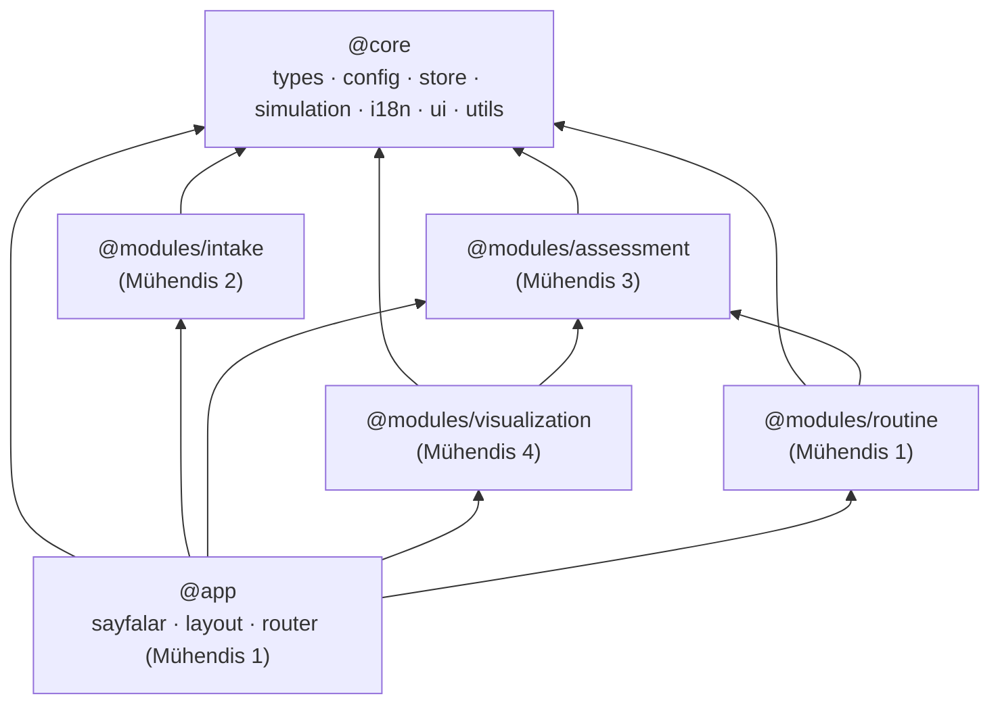
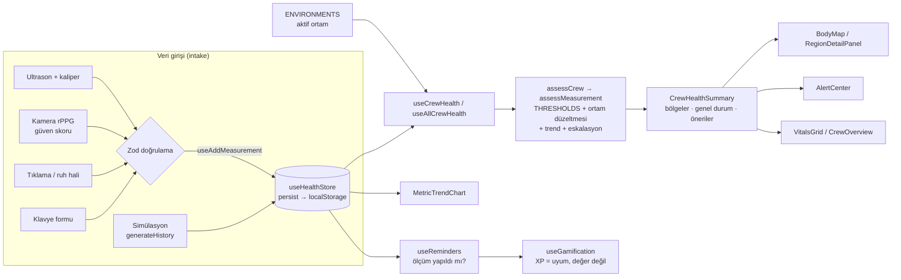

# ARCHITECTURE — Katmanlar, Bağımlılıklar, Veri Akışı

## 1. Genel bakış

AstroVital, **tamamen tarayıcıda çalışan** (backend yok, offline-first) bir React SPA'dır. Uzay
aracında internet olmadığı varsayılır: tüm kaynaklar (i18n metinleri, eşikler, simülasyon) bundle
içindedir; veri `localStorage`'a (Zustand persist) yazılır, ultrason görüntüleri (P1) IndexedDB'ye.

```
src/
├── main.tsx            giriş noktası (i18n init + <App/>)
├── app/                KABUK — sayfalar, layout, router, provider'lar (Mühendis 1)
├── core/               ÇEKİRDEK — tipler, config, store, simülasyon, i18n, UI kit, utils (Mühendis 1)
├── modules/
│   ├── intake/         VERİ TOPLAMA (Mühendis 2)
│   ├── assessment/     DEĞERLENDİRME & YÖNLENDİRME (Mühendis 3)
│   ├── visualization/  VÜCUT HARİTASI, GRAFİKLER (Mühendis 4)
│   └── routine/        HATIRLATMA & OYUNLAŞTIRMA (Mühendis 1)
└── test/               ortak test altyapısı (@test/*, yalnız __tests__ içinden)
```

## 2. Modül bağımlılık grafiği (döngü yasak)



Ok yönü = "import eder". Kurallar ESLint `no-restricted-imports` ile **derleme öncesi** zorlanır
(`eslint.config.js > boundary()`), ayrıca `tsconfig.app.json > paths` modüller için yalnızca
`index.ts`'i tanımladığından derin import TypeScript'te de çözülemez (çift koruma).

| Kural                                       | Örnek ihlal                                                         | Hata mesajı                                                                                               |
| ------------------------------------------- | ------------------------------------------------------------------- | --------------------------------------------------------------------------------------------------------- |
| Derin import yasak                          | `@modules/assessment/engine/assessCrew`                             | Deep import into another module is forbidden                                                              |
| Grafik dışı bağımlılık                      | intake → `@modules/assessment`                                      | [intake] may not depend on this module                                                                    |
| Modül kendi index'ini import edemez         | intake → `@modules/intake`                                          | importing your own public API creates cycles                                                              |
| Katman dışına göreli import                 | `../../core/types`                                                  | Relative import crosses a layer/module boundary                                                           |
| Uygulama kabuğu yalnız app'ten              | intake → `@app/router`                                              | may not import from the app shell                                                                         |
| Test yardımcıları yalnız testlerden         | bileşen → `@test/...`                                               | `@test/*` is test-only infrastructure                                                                     |
| Base UI / Radix yalnız `src/core/ui` içinde | intake/app/core-store → `@base-ui/react`, `radix-ui`, `@radix-ui/*` | Headless UI kütüphaneleri (Base UI, Radix) yalnız src/core/ui içinde kullanılır; bileşeni @core/ui'dan al |

**UI kit (ADR-029, esnek):** kit parçaları ekibin kendi bileşenleridir; görünüm Tailwind + `tokens.css`.
Konumlanan/odak yöneten parçalarda (açılır menü, popover/tooltip, modal) gerektiğinde headless **Base UI
veya Radix** kullanılır — seçim parça bazında, envanterde "Motor" sütununda — ve **yalnız
`src/core/ui` altında** import edilir. Diğer core klasörleri, modüller ve app yalnız `@core/ui`'dan
alır; kütüphane tipleri kitin public API'sinden dışarı sızmaz, bu yüzden motor değişikliği modülleri etkilemez.

**Paylaşılan veri dosyaları:** bir veri dosyası (ör. gömülü uzay ajansı verisi) yalnız tek modülde
kullanılıyorsa o modülün klasöründe durur. Birden fazla modül veya `core/simulation` kullanacaksa
`src/core/config/` altına konur; içerik sahibi veriyi getiren mühendis, merge onayı Mühendis 1
(`thresholds.config.ts` düzeni). Gerekçe: oklar tek yönlü — modüller core'dan okuyabilir, core hiçbir
modülden okuyamaz (ESLint).

Faz 0'da bu kuralların 8 farklı ihlal örneğinde hata verdiği doğrulandı (bkz. DECISIONS.md ADR-004).

## 3. Katman sorumlulukları

| Katman                      | Sorumluluk                                                                                     | Yasaklar                                                               |
| --------------------------- | ---------------------------------------------------------------------------------------------- | ---------------------------------------------------------------------- |
| `core/types`                | Tüm paylaşılan sözleşmeler                                                                     | Çalışma zamanı kodu yok (sadece `type`)                                |
| `core/config`               | Metrik kataloğu, eşikler, ortamlar, tehlikeler, bölgeler, kaynak kaydı                         | React yok, store yok                                                   |
| `core/store`                | Paylaşılan alan verisi: ölçümler, mürettebat, aktif ortam, ayarlar                             | Modül-yerel UI durumu (uyarı onayı, XP) burada DEĞİL                   |
| `core/simulation`           | Seed'li, saf demo verisi üretimi                                                               | `Date.now()` / `Math.random()` yok                                     |
| `core/ui`                   | UI kit: kendi bileşenlerimiz, görünüm token'lardan; gerektiğinde Base UI veya Radix (headless) | `t()` çağırmaz — çevrilmiş metin alır; kütüphane tipleri dışarı sızmaz |
| `core/i18n`                 | EN/TR kaynaklar                                                                                | —                                                                      |
| `modules/assessment/engine` | Saf kural motoru                                                                               | store/React yok; `ctx.now` kullanır                                    |
| `modules/*/components`      | Modülün UI'ı                                                                                   | Başka modülün içine bakmaz                                             |
| `app`                       | Sayfaları birleştirir, provider'lar                                                            | İş kuralı yazmaz                                                       |

## 4. Veri akışı (uçtan uca)



**Örnek senaryo (Faz 2 hedefi):** Astronot nabzını 128 bpm girer → `useAddMeasurement` ölçümü
store'a yazar → `useCrewHealth` yeniden hesaplar → motor bandı `red / crew_medical_officer`
bulur → kalp bölgesi kırmızı ve hızlı atmaya başlar → `AlertCenter`'da uyarı + "yeniden ölç"

- "CMO'ya bildir" önerisi → `useReminders` sabah nabız görevini "yapıldı" işaretler → +XP.

## 5. Durum yönetimi

- **Tek global store** (`useHealthStore`, anahtar `astrovital:health`, versiyon 1). Şema değişirse
  `version` artırılır ve `migrate` yazılır (Mühendis 1).
- **Modül-yerel store'lar** serbesttir: ör. `astrovital:assessment` (uyarı onayları),
  `astrovital:routine` (XP, rozet). Başka modül bunlara doğrudan erişemez; gerekiyorsa
  `index.ts`'ten hook export edilir.
- Türetilmiş veri (değerlendirme) **asla persist edilmez**; her zaman ölçümlerden hesaplanır.

## 6. Tema ve erişilebilirlik

- Tasarım token'ları `src/core/ui/tokens.css` içinde CSS değişkenleri; `src/index.css` bunları
  Tailwind 4 `@theme inline` ile `bg-surface`, `text-ok`, `text-warn`, `text-crit`, `text-env` gibi
  sınıflara eşler. `<html data-env="mars_base">` ortam rengini değiştirir.
- Durum = **renk + ikon + metin** (`StatusBadge`). `prefers-reduced-motion` nabız animasyonunu kapatır.
- `lg` butonlar ≥56 px (eldivenle kullanım).

## 7. Test stratejisi

| Katman                                              | Araç                                                       | Hedef                                        |
| --------------------------------------------------- | ---------------------------------------------------------- | -------------------------------------------- |
| Saf fonksiyonlar (motor, simülasyon, utils, config) | Vitest                                                     | Motor ≥%90 kapsam                            |
| Bileşen                                             | React Testing Library + jsdom                              | Her public bileşen için en az 1 render testi |
| Entegrasyon                                         | `src/app/__tests__/routes.test.tsx`                        | Tüm rotalar açılıyor + feragat görünür       |
| Sözleşme                                            | `contracts-sync.test.ts`, `keys.test.ts`, `config.test.ts` | Dokümanlar/i18n/config kaymasını yakalar     |
