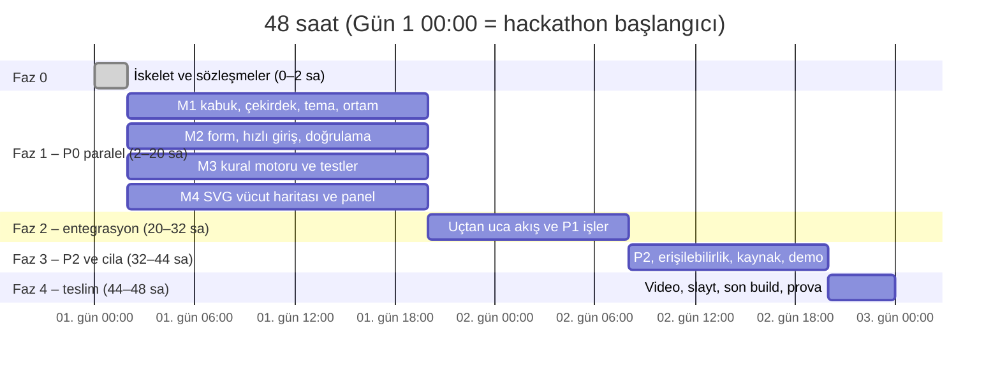

# PLAN — Faz Planı, Zaman Çizelgesi, Kabul Kriterleri

**Varsayım:** 48 saatlik hackathon, 4 mühendis paralel. Saatler hackathon başlangıcından itibaren.
Görev listeleri: `docs/modules/*.md`.

## Zaman çizelgesi

## Faz 0 (0–2 sa) — İskelet ✅

**Çıkış kriterleri**

- [x] `npm run dev | build | test | lint | typecheck` yeşil
- [x] Tüm sayfalar stub bileşenlerle açılıyor (`src/app/__tests__/routes.test.tsx`)
- [x] Demo verisi yüklenebiliyor (ilk açılışta otomatik + Settings > "Demo verisini yükle")
- [x] `src/core/types` sözleşmeleri + `docs/CONTRACTS.md` birebir (testli)
- [x] ESLint modül sınırları doğrulandı (ADR-004)
- [x] Git: `main` üzerinde scaffold commit'i + 4 feature branch

## Faz 1 (2–20 sa) — Paralel P0

Her mühendis kendi branch'inde stub'ları gerçek implementasyonla değiştirir. **Sözleşme
değişmez** (değişecekse CONTRACTS.md protokolü).

**Kabul kriterleri**

- Mühendis 1: koyu "mission control" teması cilalı; 5 ortam seçilebiliyor ve ortam tonu değişiyor;
  6 senaryo Settings'ten yüklenebiliyor; MET saati; UI kit tamam.
- Mühendis 2: klavye formu (birim dönüşümü, KB çifti `groupId`, makul olmayan değer uyarısı),
  hızlı giriş (ruh hali, uyku kaydırıcısı, büyük butonlar), çoklu mürettebat seçimi; her girişte `source`.
- Mühendis 3: `assessMeasurement` gerçek (bantlar + ortam düzeltmeleri + trend + sustained +
  eskalasyon + radyasyon kümülatif/SPE); motor kapsamı ≥%90; her kırmızıda "yeniden ölç".
- Mühendis 4: SVG insan figürü, 10 bölge, hover, durum renginde nabız animasyonu, klavye ile
  gezinme, `RegionDetailPanel` animasyonlu.

**Ara kontrol (10. saat):** her branch main'e en az 2 kez merge edilmiş, `npm run verify` yeşil.

## Faz 2 (20–32 sa) — Entegrasyon + P1

**Uçtan uca akış (kabul testi):** ölçüm gir → değerlendirme → vücut haritası rengi değişir →
öneri + eskalasyon → hatırlatma "yapıldı" + XP artar.

- Mühendis 1: hatırlatma sistemi (ortama göre takvim, toast + Notification API), kaçırılan
  ölçüm takibi, oyunlaştırma (XP, seri, rozet, ekip skoru, günlük görevler).
- Mühendis 2: kamera rPPG (güven skoru, manuel düşüş), ultrason yükleme + kaliper + IndexedDB.
- Mühendis 3: öneri kütüphanesi, `AlertCenter` (öncelik + onay), `LearnPanel` tam içerik.
- Mühendis 4: `MetricTrendChart` (eşik bantları, anomali noktaları, canlı), `VitalsGrid`
  sparkline, `CrewOverview` zenginleştirme.
- Entegrasyon testi: `src/app/__tests__/e2e-flow.test.tsx` (Mühendis 1 yazar, herkes besler).

## Faz 3 (32–44 sa) — P2, cila, doğrulama

- Kaynak doğrulama (SOURCES.md ⏳ → ✅), THRESHOLDS/HAZARDS güncel (Mühendis 3).
- Erişilebilirlik turu: klavye, ekran okuyucu, kontrast, `prefers-reduced-motion` (herkes).
- Ortam temaları, sunum modu (Mühendis 4); JSON/CSV dışa/içe aktarma, demo modu, code splitting
  (Mühendis 1); OCR / sesli giriş / ölçüm rehberi (Mühendis 2); flight surgeon raporu (Mühendis 3).
- DEMO_SCRIPT.md provası #1.

## Faz 4 (44–48 sa) — Teslim

- Demo videosu (≤3 dk) ve slaytlar, proje açıklaması (Space Apps sayfası).
- `npm run verify` → `npm run build` → `dist/` son kontrol (offline, farklı klasörden açma).
- DEMO_SCRIPT.md provası #2 (zamanlı).

## Risk listesi

| Risk                                  | Etki                   | Önlem                                                                    |
| ------------------------------------- | ---------------------- | ------------------------------------------------------------------------ |
| Sözleşme değişikliği zinciri          | Paralel işin kırılması | CONTRACTS protokolü, sadece ekleme, Mühendis 1 onayı                     |
| Kamera rPPG güvenilmezliği            | Demo'da başarısızlık   | Güven skoru + manuel düşüş; demo'da simüle akış                          |
| localStorage kotası (180 gün)         | Yükleme hatası         | Varsayılan 30 gün; P2'de IndexedDB                                       |
| Kaynak doğrulama yetişmez             | "Geçerlilik" puanı     | Faz 3 başında 2 saat ayrılmış blok                                       |
| Merge çatışması (`en.json`/`tr.json`) | Zaman kaybı            | Anahtarları modül önekli ekle (`intake.*`, `visualization.*`), sık merge |
